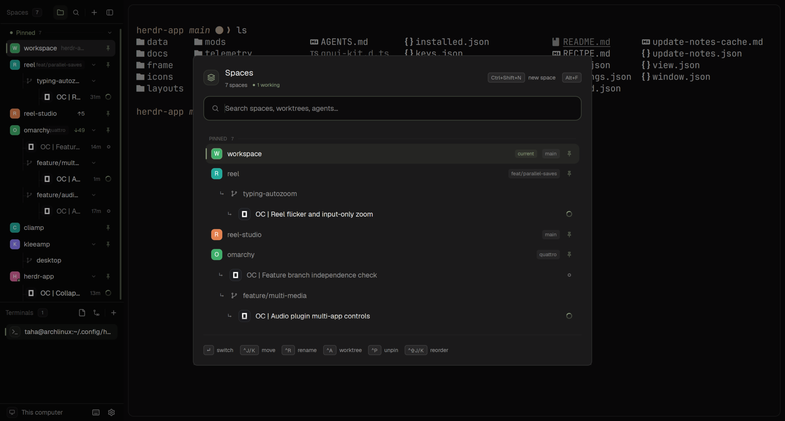

# Herdr Workspace

A Herdr window with no tab bar, driven entirely from the keyboard: every action
has a key, from anywhere. `Alt+F` opens the find palette: every space,
worktree, agent and terminal in one tree, searched by name, branch, folder,
title or state, and it acts — go, pin, rename, reorder, close, make a space,
make a worktree. The sidebar keeps pins in their slot, groups agents by what
they need, shows every terminal's program and status, nests worktrees and
sub-agents, and folds to a compact rail when narrow. Panes are cards; focus
follows the pointer.



## What you see

Left to right:

**The sidebar**, 223 px wide, `chrome` background, no divider of its own (the
window edge is its edge), not resizable by its edge — it collapses instead.

- **`AGENTS`** (top, 2.15 weight, min 90 px): a 42 px header (8 px above the
  label, 6 below, a hairline under it) with a `9.5 px` semibold muted `AGENTS`
  label, a count pill, and three 26 px buttons — sort (clock), search
  (magnifier), collapse sidebar (panel icon). Under it, status groups: each header
  is 27 px with 6 px above — a status dot, a `9.5 px` semibold label, a count
  pill and a hairline, with a chevron to fold the group. Rows are 30 px: a 20 px
  program tile, the agent's name at `12.5 px` (foreground when the row is focused), an
  optional space chip, the time since its state changed (`<1m`, `2m`, `1h`,
  `3d`) and a trailing status mark.
- **`TERMINALS`** (bottom, 0.85 weight, min 90 px): a 38 px header with
  `Terminals` (11.5 px, the default UI font), a count pill, Files and Changes
  buttons, a 1 px divider and a `+`.
  Rows are 28 px: a 20 px tile (the agent's own program mark; a terminal keeps
  the app's terminal icon), the title at `12.5 px` (medium when focused), the
  tab's name in a `9.5 px` chip when the space has more than one tab, and a 6 px
  status dot.
- **The footer**, 32 px, `chrome` background with a hairline above: a 20 px
  monitor/server tile and the machine's name at `11.5 px` on the left, a keyboard
  and a gear on the right, 26 px each.
- **A bar of its own.** When a list outgrows its box, a 3 px `accent` thumb sits
  3 px in from the panel's edge — fully rounded, no track, 4 px while the
  pointer is on the bar. The list scrolls inside the mod (`scroller` in
  `sidebar.js`): the wheel moves an offset, the rows are drawn at it, and the
  thumb is the mod's. Reaching a row from the keyboard sums each row's measured
  height (`reveal`).

**The work area**, `canvas` background, 8 px padding and 8 px gaps: the active
tab as cards — 10 px radius, 1 px `border` (1 px `accent` while the pane has the
keyboard), `background` fill, 8 px between panes, framed even when the tab has a
single pane. Terminal text sits 14 px from the top and 12 px from the side.
Every pane also carries an invisible `hoverfocus` header, 5000 px tall and
revealed only on hover; it draws nothing and runs `pane.focus`, so moving the
pointer onto a terminal focuses it.

**No floating tabs.** Narrow, the sidebar is the rail; `Ctrl+Shift+B` folds it
there and unfolds it at the width it had. There is no hidden state to rescue.

The whole window has no title bar; on macOS the traffic lights sit at (12, 16).

## How it behaves

**Agent status** — the state is never a word, always a mark:

- *working*: a spinning ring in `theme.accent` (900 ms per turn) at the row's
  trailing edge, and in the group header a dot of the same colour. The terminals
  list shows a 6 px accent dot for the same terminal.
- *blocked*: a `Needs you` chip — `blocked` at 12 % fill, `9.5 px` semibold — in
  the row, the same chip in a full-width header, and just `!` in a compact row
  where the header already says it.
- *done*: a filled 6 px dot in `theme.done`. The row stays in the `Done` group
  after you look at it (it becomes idle) until you leave the space, so a finish
  you just noticed does not jump away under the pointer.
- *idle*: a hollow 6 px ring with a 1.5 px `idle`-coloured edge — quiet enough to
  scan past.

Groups are ordered `Needs you` → `Done` → `Working` → `Idle`, each with its
count; a `Pinned` group sits above them all when an agent is pinned. The sort
button switches between three views. *Priority* and *Grouped by space* are the
app's own list, unchanged: small program icons, rows that read "space · detail",
a quiet group heading with a count, a paragraph when nothing has reported. Only
the third is this mod's drawing.
*Spaces with agents*: the find palette's tree, always on screen — a section per
space urgency, every space listed (the ones no agent runs in too), a worktree
space under its checkout, and its agents nested under it. The rows are drawn the
way Herdr's own spaces list draws them: an 18 px avatar with the space's initial
in its colour (a branch icon for a worktree), the name as given, and the repo or
branch plus `↑ahead`/`↓behind` on the right only where they are unusual, in fixed
slots so a branch coming and going never moves the counts. A worktree, an
unopened checkout and a nested agent all hang off the same 1 px hairline gutter
with a tick into their icon; the space in use wears a 2 px accent spine and an
accent ring on its avatar, and a pinned row carries its state dot beside its name
(the Pinned ribbon is the one section not named after a state). A pin is quiet
until the pointer is on the row, so a column of them reads as a stripe rather
than as five buttons. Exactly one row in the list is filled — the space the
window shows; an agent with the keyboard is marked by a ring on its tile, never
by a second filled row under the first, so a nested agent cannot masquerade as
part of its space.

**Counts mean spaces.** The sidebar's header pill and the sheet's subtitle count
places to work — never agents, never the worktrees hung under their repo — so the
number matches the spaces you can name (a worktree space is drawn under its
checkout and is not counted again). A pin's glyph belongs to a space row: an
agent's pin lives in its right-click menu, a worktree row shows none (hovered or
not, in the sidebar and in the sheet), and neither the worktree's space menu nor
the sheet's `Ctrl+P` offers to pin one — a pin keeps a place, and a checkout is
not a place of its own.

**A pinned space is never closed, and nothing else is protected with it.** The pin
is the promise: the sidebar's two-second sweep skips a pinned space even when its
folder is gone (it stays in the list, named `(deleted)`, with one toast), the space
menu does not offer "Close space" while it is pinned, and the sheet answers `Ctrl+D`
with a line instead of a dialog. A pin is also the place: its row keeps the slot it
was pinned in, and a space opened where a pinned space used to be — the pin row's
own click, or one made in that folder — takes that pin, so the row comes back
pinned in the same line. Two spaces in one folder are two places, and the pin waits
as a place row instead of guessing which one it means. A place keeps the repo it
names: with the space gone, its unopened checkouts and the worktree spaces that
hang under no space any more stay under the place row, whose avatar keeps the
colour the space wore, and the sidebar keeps reading that repo while no space
stands there, so a space opened there binds its checkouts at once instead of after
a scan. A pin covers only that space: its worktrees stay
removable — the sheet's `Ctrl+D` and the sidebar's menu and `x` still ask and then
delete the checkout, closing only the spaces that are not pinned, and a pinned space
standing in that checkout stays behind (its folder goes, the space does not) — and
its agents still stop. A removal only names a space when that checkout is the one
the space stands in: an unopened checkout's dialog says "Deletes … The branch
stays." and never mentions closing anything. A removal is optimistic — the press
is the answer: the checkout leaves the list at once and the dialog closes, then
git runs behind it (the sidebar does the work, because a dialog's tasks end with
it) and the spaces close when git has actually removed the folder. Only a failure
brings the row back, with a toast saying why, and closes no space. Stopping an
agent never takes its space either — where the agent is the
only terminal in the space, a shell opens there first, and the dialog says so.
A dialog opened from the sidebar hands the keyboard back to the list when it
closes, so a removal never drops the person into the terminal behind it.

The sidebar's keys are the find palette's own, so one map works in both places:
`Ctrl+J`/`Ctrl+K` walk the rows (Up/Down too), `Enter` goes there, `Ctrl+D`
closes the space / stops the agent / removes the worktree, `Ctrl+P` pins,
`Ctrl+R` renames, `Ctrl+A` starts a worktree of the row's repo, and
`Ctrl+Shift+J`/`Ctrl+Shift+K` move the space a row — held down, they keep
stepping, at the same 70 ms pace as the sheet, aimed past the row they just
left so two quick presses do not aim at the same neighbour. `Esc` leaves, and
`N`, `G`, `F` stay for a new space, opening a worktree and folding. Walking with
`Ctrl+J`/`K` goes through the sidebar itself, like the sheet's: the app's keymap takes
those keys, so the sidebar says `shared("sidebar.kb")` while it holds the
keyboard and answers with `shared("sidebar.move")`, polled only then. The
sidebar owns the layout's keys (`Ctrl+J/K`, the flip, close pane/tab, a new
worktree and `Ctrl+Shift+B`) because it stays mounted when the rail folds and
the footer and the terminals list are put away.
The sheet lists all of these under "Sidebar · with its keyboard"; the
sidebar itself draws no hint row. Adding or removing a space from the list keeps
the keyboard there: the sidebar re-claims its focus handle as the app settles
(40/140/340/700 ms), and a removal that closes spaces only after git re-claims
only if the person is still in the list. A press anywhere outside the panel ends
keyboard mode — even on the footer or the background, where the app leaves the
focus where it was — and a press inside brings it back. Opening a row does not
pull focus back to the pane that was current: the action's own focus stands.

Each section ribbon is an 11 px medium label in the default UI font, title
case ("Pinned", "Needs you"), its count, a hairline, and the fold chevron; a
folded space says how many rows it hides and how urgent the most urgent of them
is. The panel's own heading is "Spaces" (or "Agents") at 11.5 px, the way
Herdr's default lists read. Right-click opens the space menu (rename,
new/open/remove worktree, close, new space), and an unopened checkout has its own
menu (open it, remove it). Drag reorders inside a section; the chevron folds.
With more than one machine the list is grouped by it — this computer first, then
servers by name, each with a connection dot, its own `+`, the `hc machine login …`
command with Copy when one needs a login, and Connect when a machine was rebuilt.
Folding a group is per session; a folded machine header still shows how many
spaces it holds and how urgent they are. With no spaces at all the view says so
and offers to make one.

**In the sidebar**

- Click an agent row: that agent gets the keyboard (`agent.focus`). An agent's
  pin lives in its right-click menu (`terminal.pin`), not on the row; a space row
  reveals its own pin button on hover (accent when pinned, `setPin`). A sub-agent
  sits indented under its parent behind a `↳`, with its own state mark.
- Click a terminal row: `tab.select` then `pane.focus` — the row is the tab and
  the pane at once. Clicking the `Files` or `Changes` button shows that panel on
  the right (accent while shown) and clicking it again hides the panel, per
  space. The `+` makes a tab in the space. The tab chip says which tab a row
  belongs to when there is more than one; the status dot is the agent's.
- Right-click a terminal row: Herdr's own pane menu, aimed at *that* pane. Right-
  click anywhere in the sidebar (headers included): this setup's menu, with two
  rows — *Move sidebar to the right/left* (`Ctrl+Shift+M`) and *Collapse sidebar*
  (`Ctrl+Shift+B`) — each showing its key.
- Drag the footer: the window moves (the strip is the drag handle; its buttons
  stop the press). `Ctrl+Shift+B` folds the sidebar into the rail, and again opens
  it at the width it had; there is no hidden state and no floating tab.
- Narrower than 160 px, the sidebar is a rail. The agents list becomes a column
  of 26 px cells with tooltips, centred in the rail: an unfold chevron at the top,
  the space's avatar and its state mark, and search, shortcuts and settings on the
  window's bottom edge. The avatar is the space's first letter in its colour — the
  way the expanded rows draw it — so a place is recognisable without its name; the
  current space wears the accent ring. The state mark sits on the avatar's corner:
  a spinner while working, `!` when something needs you, a filled dot when done and
  a hollow ring when idle; a space where nothing has reported stays bare. Worktrees
  do not get a cell: they are checkouts under a repo, and the expanded tree and
  search still hold them. The first nine places get a cell; a tenth turns the rest
  into one `…` that expands the sidebar. The terminals list and the footer draw
  nothing at this width, so the agents block puts them away while the rail is
  shown and gives them back when the sidebar widens — only the blocks it hid
  are put back, and the list is remembered, so a restart while collapsed
  restores them too. From 160 to 210 px the labels and the machine name drop
  out, the lists stay.

**In the panes**

- Move the pointer onto a terminal: it takes the keyboard (`pane.focus`), no
  click. The `hoverfocus` header stays transparent, so the pane looks the same;
  the sidebar's agent and terminal rows remain click-only.

**Keys this layout adds** (see the table in `docs/bindings.md`)

- `Alt+F` the find palette; `Ctrl+Shift+X` closes the focused pane, `Ctrl+Shift+W`
  its tab — closing the last pane of a tab closes the tab, and closing the last
  tab of a space opens a fresh tab in that space first, so Herdr never jumps to
  another space's terminal.
- `Ctrl+J` / `Ctrl+K` move focus down/up through panes (`pane.go`), or move the
  highlight in the find palette while it is open.
- `Ctrl+Shift+M` flips the whole sidebar to the other side (the layout's two root
  children swap, and with them the panel and the terminal pane); `Ctrl+Shift+D`
  opens the new-worktree dialog for the space you are in.
- Those keys, and `Ctrl+Shift+X` / `Ctrl+Shift+W`, are `agents-list.*` commands on
  the sidebar. It stays mounted when the rail folds and the footer and the
  terminals list are put away.

**The find palette** (720 × 560, opened by `Alt+F` or the sidebar's magnifier)

- Pinned places first, in the order the pins were made (a place whose space is
  gone keeps its line), then every space, with worktrees nested under their space
  and agents under theirs behind a `↳`. The active space wears a `current` badge
  wherever it appears; in the Pinned section a row also carries its state dot,
  since that section is not named after a state.
- The header is a live summary: how many spaces, then one clickable chip per
  state that has something in it (`2 need you`, `1 working`). A chip is also the
  filter it names, so the fastest way to the blocked work is one click and Enter.
- Type to filter (keys, not fields: the whole dialog takes the keyboard). Every
  term must land somewhere, and terms may land in different places, so
  `kleeamp desk` finds the space and its desktop checkout, `needs` finds what is
  blocked, and the matched characters are drawn semibold in the row. `↑`/`↓` to
  move, `Enter` to go (space → select it, agent → focus it, worktree → open it,
  pin → open a space there, or go to the space already there).
- **`Ctrl+J`/`Ctrl+K` are shared with pane movement, and separated by the panel.**
  `keys.json` (under `layout:workspace`) binds them to `agents-list.dir_down`/`dir_up`,
  which moves pane focus when no panel is open, hands them to the find palette when
  it is (`shared("search.open")` → `shared("search.move")`), and to the sidebar
  when its keyboard is there (`shared("sidebar.kb")` → `shared("sidebar.move")`).
  Both panels poll every 70 ms. Each also handles `ctrl+j`/`ctrl+k` itself in case
  nothing binds them. One press is one row, never two. `Ctrl+P` pins or unpins the row, `Ctrl+R` renames the
  space, `Ctrl+A` makes a worktree for the selection, `Ctrl+Shift+J`/`K` slide the
  highlighted space through the order, `Ctrl+Backspace` deletes a word, `Esc` closes.
- **A hit comes with what it belongs to, all the way up.** A matched branch (a
  checkout row) is drawn under the space that holds it, a matched worktree space
  under its repo's space, and a matched agent under the space it runs in — and a
  hit inside a worktree climbs to the top of the family (`rootOf`), so a branch is
  never drawn as a place of its own. The typing lands the highlight on the hit
  itself, never on the parent that came along with it (`search()` marks rows
  `hit`, the render resolves `at = -1` to the first hit).
- `Ctrl+D` closes what is highlighted: a space (the space dialog, which is the
  worktree-remove dialog when the space is a worktree), a worktree (remove), a pin
  row (just the pin) or an agent (a dialog asks first; a sub-agent is refused with
  a toast, it reports to its parent).
- The footer of the sheet is its own cheat line: `↵ switch`, `^J/^K move`,
  `^R rename`, `^A worktree`, `^P unpin`/`^P pin`, `^⇧J/^⇧K reorder`.
- **A step is one place, and only a space steps.** A step is one place in the
  space order (over the agent and worktree rows between spaces, and past the
  pinned/unpinned line, which pins or unpins so the row lands where it was put).
  It reads `aimedReorder()`, not `spaces()`: a `space.move` lands asynchronously,
  and reading the app's order twice within one frame aimed two presses at the
  same neighbour — the second then did nothing ("it only moves one row"). The aim
  is trusted for 1.2 s and only while it still lists the same spaces. With a
  search the footer says where the space landed (`reel-studio · 2 of 5`), since a
  ranked list does not move; at either end of the order nothing happens, and
  nothing is said. **Only a space row moves** — a worktree row, an agent row and a
  pin row are not places in the order, so they get no `move` hint and the keys do
  nothing on them.

**The rest of the furniture**

- The keyboard icon in the footer opens a searchable keys sheet (660 × 580): one
  row per command, every key for it together, the command's first clause as the
  label, the full text and all keys in a tooltip.
- Worktrees are Herdr's own (`<home>/.herdr/worktrees/<repo>/<branch>`): a dialog
  asks for the branch and makes or opens one, and removing one takes its pins out
  of the find palette.
- A space whose folder is gone is named `… (deleted)` by Herdr; after six seconds
  the footer closes that space and drops its pin, so a deleted checkout cannot
  come back from the find palette.

## Built from

The layout, `layouts/workspace.json` (a clone of Herdr's `main`, 0.1.14):

```
row root                     background canvas · theme {light,dark: omarchy}
                             terminal_padding [14,12] · titlebar none
                             traffic_lights [12,16]
├─ column sidebar            223 px · min 44 · max 480 · background chrome ·
│  │                         resizable false
│  ├─ column sidebar-lists
│  │  ├─ block agents        mod agents-list · props {sidebar:true} ·
│  │  │                      weight 2.146 · min 90
│  │  └─ block terminals     mod terminals-list · weight 0.854 · min 90
│  └─ block sidebar-footer   mod footer · 32 px · window_drag
└─ column work               resizable false
   └─ row work-body          padding 8 · gap 8
      ├─ block main          tab active · pane {radius 10, gap 8, border 1,
      │                      focus accent, background, lone true,
      │                      header hoverfocus 5000 hover}
      └─ column panel        368 px · min 280 · max 900 · hidden
         └─ stack panel-body active files
            ├─ block files   mod files (Herdr's)
            └─ block changes mod changes (Herdr's)
```

Mods, all `"place": "none"` (the layout decides where they draw):

| Mod | Props | What it does |
|---|---|---|
| `agents-list` | `{sidebar:true}`; no props: the `Alt+F` palette; `{menu}` / `{sortMenu}`: its popups | The sidebar and the find palette, one mod. `workspace-engine.js` is the logic both use (spaces, pins, removals, worktrees, order, row actions); `sidebar.js` and `palette.js` are the two drawings. `agents()`, `setAgentOrder`, `terminal.pin`, `agent.focus`, `keys()`; agent state in `localStorage` (`changed`) and the sort in shared `agents.sort`. |
| `terminals-list` | — | The TERMINALS list. `panes()`, `spaces()`, `focused()`, `tab.select`, `pane.focus`, `tab.new`, `tab.close`, `pane.close`, `layout.show/hide/select`; panel choice per space in `localStorage` (`panels`). |
| `footer` | — | The footer and the sidebar menu trigger, plus the deleted-space sweep. It still answers `dir_down`/`dir_up`, `flip_layout` and `worktree_new` when a key is rebound onto it. `spaces()`, `layout()`, `layout.set`, `shared` `sidebar.width`, `sidebar.collapsed`, `spaces.pinned`, `search.open`, `search.move`. |
| `icons` | — | Icons every other mod loads (`mods/icons/*.svg`), plus a top bar used by other layouts: space chip (`git worktree list --porcelain` for the repo's name), search, settings, sidebar toggle, window buttons where the OS draws none. |
| `shortcuts` | overlay | The keys sheet. `keys()`, `commands()`. |
| `worktrees` | `{space?, folder?, machine?, action}` or `{agent}` | Dialogs: new, open, remove worktree; remove a space; stop an agent. Runs `git worktree list/add/remove` with `exec`, `spaces()`, `space.new/close`, `terminal.kill`; finds `$HOME` with `sh -c 'printf %s "$HOME"'` (PowerShell on Windows). |
| `sidebar-menu` | overlay | The sidebar's right-click menu. `layout()`, `layout.set` (flip), `layout.resize` (collapse/expand), `keys()` for the hints. |
| `pane-header` | — | Optional pane header (program, folder, working/needs-you/done, split, zoom, close). Not used by this layout. |
| `hoverfocus` | — | The transparent pane header this layout uses: on pointer entry it runs `pane.focus` for its `props().pane` when the window is active, so terminals follow the mouse. Renders nothing for mod panes. |

The keys are the repository's `keys.json`: `install.sh` updates its
`layout:workspace` section in the person's file and adds its `global` and
`terminal` keys only where theirs has none, so the file they read is the file
they install while their own bindings are kept. `docs/bindings.md` lists every
key that file holds, plus the keys the panels read themselves, and embeds the
file ready to copy; `tests/bindings.test.mjs` fails when a key is missing from
the page, when the page names a key the file lost, when the embedded copy
drifts, or when `install.sh` keeps a map of its own.

Art: every icon is an SVG in each mod's folder, drawn with `svg()` so it takes
the theme's colour; program marks come from the app's program table (`icons/`).
No images, no fonts of our own.

Settings the look assumes: `font_size: 16`, `ui_font: "Geist"`,
`font_ligatures: false`, and `themes/omarchy.json` (background `#0c0b0c`,
foreground `#c1c1c1`, selection `#333333`, accent/solid `#8a9a7b`).

## Watch out

- **Ids are the contract.** `sidebar`, `agents`, `terminals`, `sidebar-footer`,
  `main`, `panel`, `panel-body`, `work-body`, `sidebar-lists` are all found by id
  from mods. Renaming one silently drops a panel or the flip half.
- **The sidebar and the sheet are one mod, and cannot be split again.** Herdr
  rejects an import outside a mod's own folder (and a symlink to one), so the
  shared rules in `workspace-engine.js` only work with both views in `mods/agents-list/`.
  The sheet draws `mods/agents-list/{layers,pin,x}.svg` from its own folder.
  Its cross-mod needs are the `worktrees` dialogs behind `Ctrl+A` and `Ctrl+D`.
  The sidebar owns the `Ctrl+J`/`Ctrl+K` handshake itself (it is mounted on the
  rail); `↑`/`↓` work without the handshake. The footer still answers those commands if a key is pointed at it. The layout's block must carry `"props": {"sidebar": true}`: without
  it the block is the sheet.
- **The root draws its view itself; it never hands back a `cx.new` child.**
  Herdr re-renders a mod's root view on every live change (spaces, agents,
  terminals, focus, shared state) and stops there. A retained child is rebuilt
  only when *it* is notified, so mounting the sidebar and the sheet with
  `cx.new` left the panel up to a minute behind — a sort chosen in the popup, an
  agent's status, or a space selected from the keyboard arrived only when one of
  the panel's own timers happened to fire (the highlight stayed on the old
  space). `main.js` builds the view with `new`, calls its `init(props, cx)` with
  the root's context, and returns `this.inner.render(cx)`; `close(cx)` forwards
  to the view's own teardown.
- **The shared picture is written only when it moved.** `persistWorkspace`
  compares the picture without `at` (when it was written). Including it made
  every scan look like a change, so an idle window rewrote shared state — and
  therefore repainted every mod — once per eight-second scan.
- **The worktree tree is one function, `worktreeTree` in `workspace-engine.js`.** Both views
  pass it their git answer and it returns which space holds each worktree and
  each unopened checkout. Do not build parent maps in a view: the sheet's copy
  silently fell over (helpers it no longer imported) and listed every worktree
  as a bare row. The answer comes from the sticky `workspace.spacePins` record
  (below), so a shell that `cd`s out of its checkout stays nested. A row is
  labelled with the checkout's branch, never `s.name`: Herdr renames an unnamed
  space after its live folder (`test` became `tmp` after one `cd`). For the same
  reason a checkout that is opened becomes a space **named** after its branch.
- **A worktree is pinned by `--git-common-dir`, not by path.** `repo.groupKey` is
  `<machine>\0<repo>`, where `<repo>` is the main checkout for both a main
  checkout and a linked worktree (`rev-parse --path-format=absolute
  --git-common-dir`, minus `/.git`). `spacePins` keeps `{groupKey, main,
  worktreePath, root, branch, isWorktree}` per space in `shared.json`
  (`workspace.state`). A `cd` into the main checkout, a subfolder, or a folder
  with no repo keeps the record; a `cd` into a *different* repository root
  re-pins it. Never decide "worktree" from a folder prefix or a `.git` check:
  checkouts can live anywhere (`worktrees.directory`).
- **The sheet opens with no git.** `hydrateWorkspace()` fills the in-memory
  picture from `workspace.state` before the first frame. `askGit` is only called
  for an explicit creation or removal, and the sidebar's scanner is the only
  place that runs `git rev-parse` / `git worktree list`. Never call `exec` from a
  render, a status tick, or the sheet's open path.
- **Worktrees reorder in their own list.** `space.move` indexes spaces inside
  one machine's block; it cannot order checkouts. Nested worktrees (opened or
  not) step through `workspace.order[groupKey]`, a persisted path array written
  by `movePathWithin`. `machineIndexOf` is the only conversion from a drawn row
  to a `space.move` index, and a cross-machine drop is refused.
- **Half the icons are Herdr's, not this bundle's.** The mods point at
  `mods/workspace-chrome/*.svg` (search, branch, plus, spinner, chevron, check,
  server, monitor, sidebar), `mods/files/file.svg` and
  `mods/changes/changes.svg`. Those folders are Herdr's shipped mods and are not
  copied into this repository — they exist on any Herdr install, but a rebuild must
  not expect them in the bundle, and renaming a path here means drawing nothing.
- **The bar is the mod's, not the app's.** `overflow_y_scrollbar` paints a
  16 px, square, `foreground`-grey bar whose width, colours and radius are the
  base theme's; no style a mod can set reaches it. `scroller` therefore owns the
  offset: `overflow_y_scroll`, a translated content column, an `accent` thumb,
  and one measured wrapper per row so `reveal` can put a row on screen. Do not
  "simplify" it back to `overflow_y_scrollbar`.
- **The layout must be a clone.** `layout.set` — the flip and the panel's width
  bookkeeping — refuses structural edits on a shipped layout, so this file is a
  clone of `main` and must stay one.
- **Three width thresholds are hard-coded**: under 160 px the rail, under 210 px
  compact labels, under 240 px the top bar's tight mode (that last one only
  matters in `icons`'s own bar). Change the sidebar's width and those
  numbers do not follow.
- **The panel needs `workspace.panels`.** Files and Changes are shown only when
  `shared("workspace.panels")` (written by Herdr's welcome screen) lists them;
  otherwise the buttons are absent. They default to `["files", "changes"]`.
- **Pins are ids, not folders.** Two spaces in one folder can both be pinned;
  a pin without an id (older state) matches by folder, and only while no other
  live space sits there.
- **A pin is saved where the space is, not where it was made.** A space created
  in one folder and used in another is named after the second; a pin saved with
  the first opens a shell in the wrong place and comes up under another name. So
  `setPin` stores `place(space)`, and a row reads the name its click will give it
  (`pinLabel`: a named pin keeps its name, an unnamed one reads its folder).
- **A space stands in its folder** even when a terminal inside it has cd'd
  elsewhere, so `spaceAt` matches a pin against both the live place and the
  space's own folder. Matching only the live place kept a dead pin alive when its
  folder was occupied (the space was open there, just working somewhere else).
- **One place, one space.** A pin row never opens a second space in a folder that
  already has one: it goes to that space and says so with a warning toast. A pin
  whose space is gone while another space stands in its folder is dropped when
  the sheet opens (`bindPins` → `spaceAt`), so the list cannot hold two rows for
  one place. Three "herdr-app" rows is what that guard is for.
- **No paths in the sheet.** A pin row is read by its name; another machine's name
  is the only extra it shows. Where a shell starts is Herdr's own bookkeeping.
- **`theme: "omarchy"` must exist.** Without `themes/omarchy.json` the window
  falls back to Herdr's own theme and the intended contrast is gone. Omarchy's
  `omarchy-theme-set-herdr-app` rewrites that file on every theme switch.
- **`mod.open` toggles.** `Alt+F` is `mod.open:agents-list`: with the sheet open,
  pressing it again closes it — do not "open it again" to raise it. The layout
  block is a second copy of the same mod, with `sidebar: true`.
- **No git, no worktrees.** On a folder that is not a checkout the worktree rows
  and dialogs have nothing to offer; a remote space's `git` runs over `exec`'s
  `on:` there, so a disconnected machine just leaves the dialog empty.
- **Sub-agents are not killable from here**: `Ctrl+D` on one says so instead of
  ending it, because the parent owns its life.
- Worktrees live at `<home>/.herdr/worktrees/<repo>/<branch>` on the space's
  machine — the same place Herdr's own space menu uses; nothing is custom.
- No network of its own. The programs it runs are `git`, `hc` (the machine
  list and a reconnect) and a shell for `$HOME`; a remote space's `git` runs
  there, over its connection.

## Done when

- `herdr-app do layout.switch --name workspace` shows the sidebar, the cards and
  the footer, with no tab bar and no title bar.
- The keys from `docs/bindings.md` work: `Alt+F` opens the find palette,
  `Ctrl+Shift+X` closes a pane, `Ctrl+Shift+W` a tab, `Ctrl+Shift+M` swaps the
  sidebar to the right and back, `Ctrl+Shift+D` opens a new-worktree dialog.
- `Alt+F` then typing `herd` narrows the sheet to matching spaces and agents;
  `↑`/`↓` move the highlight; `Enter` switches; `Ctrl+P` pins the highlighted row
  and it appears under `Pinned` at the top with a filled pin; `Ctrl+D` on an agent
  opens the confirmation instead of closing it.
- `node tests/bindings.test.mjs` passes: every key in `keys.json` has a row in
  `docs/bindings.md`, the page names nothing the file lost, and the file block on
  the page is `keys.json` itself (install.sh merges that same file).
- An agent working shows a spinning ring; blocked shows `Needs you`; finished
  shows a filled dot and stays in the `Done` group when you look at it.
- A terminal running `ls` keeps its terminal icon (no purple flash); an agent
  keeps its program's mark.
- Dragging the sidebar narrower than 160 px leaves the avatar rail — each cell is
  the space's first letter in its colour, with its state mark on the corner (a
  spinner, `!`, a dot or an idle ring), and the current space wears the accent
  ring; widening it brings both lists back. `Ctrl+Shift+B` folds it to the rail,
  and again opens it at the width it had; no edge tab appears.
- Right-clicking the sidebar opens the two-row menu with `Ctrl+Shift+M` and
  `Ctrl+Shift+B` beside the rows; right-clicking a terminal row opens Herdr's
  pane menu aimed at that row's pane.
- The keyboard icon in the footer opens the keys sheet, where typing `search`
  finds the search binding and `Esc` closes it.
- `herdr-app check mods/<each>` passes for all nine mods, and `herdr-app status`
  reports no errors.
- The sidebar overflows: a 3 px `accent` thumb runs down its right edge with no
  track, the wheel moves the rows, pressing the track jumps, dragging the thumb
  follows the pointer, and `Ctrl+J`/`K` keeps the selected row on screen.
- The thirteen test files pass: `node tests/*.test.mjs`. They cut functions out of
  the mods and run them with stubs, so they fail when the code changes rather
  than when the test drifts.
- Reorder: `Ctrl+Shift+K` three times on the last space moves it three places
  (not one), with a search active it says where it landed, at either end nothing
  happens (no wrap, no message), and on an agent or worktree row the keys do
  nothing at all.
- Search: typing `desk` shows the space that owns that worktree above the row,
  the highlight sits on the matched row, and `Enter` goes to it.
