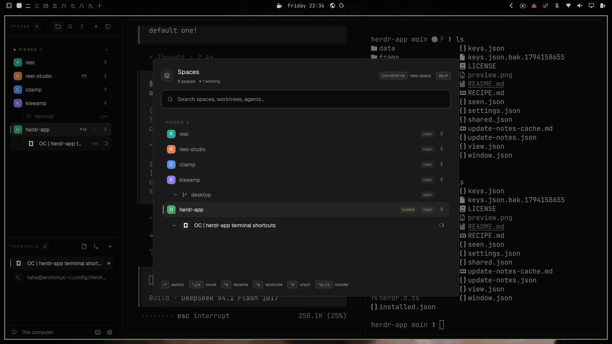

# Herdr Setup

A Herdr window with no tab bar and no top bar: one 268 px sidebar holding every
agent and every terminal of the space you are in, a footer you can drag the
window by, panes drawn as cards, and a single search sheet over it all.



## What you see

Left to right:

**The sidebar**, 268 px wide, `chrome` background, no divider of its own (the
window edge is its edge), not resizable by its edge — it collapses instead.

- **`AGENTS`** (top, 2.15 weight, min 90 px): a 42 px header (8 px above the
  label, 6 below, a hairline under it) with a `9.5 px` semibold muted `AGENTS`
  label, a count pill, and three 26 px buttons — sort (clock), search
  (magnifier), hide sidebar (panel icon). Under it, status groups: each header
  is 27 px with 6 px above — a status dot, a `9.5 px` semibold label, a count
  pill and a hairline, with a chevron to fold the group. Rows are 30 px: a 20 px
  program tile, the agent's name at `12.5 px` (foreground when the row is focused), an
  optional space chip, the time since its state changed (`<1m`, `2m`, `1h`,
  `3d`) and a trailing status mark.
- **`TERMINALS`** (bottom, 0.85 weight, min 90 px): a 38 px header with
  `TERMINALS`, a count pill, Files and Changes buttons, a 1 px divider and a `+`.
  Rows are 28 px: a 20 px tile (the agent's own program mark; a terminal keeps
  the app's terminal icon), the title at `12.5 px` (medium when focused), the
  tab's name in a `9.5 px` chip when the space has more than one tab, and a 6 px
  status dot.
- **The footer**, 32 px, `chrome` background with a hairline above: a 20 px
  monitor/server tile and the machine's name at `11.5 px` on the left, a keyboard
  and a gear on the right, 26 px each.

**The work area**, `canvas` background, 8 px padding and 8 px gaps: the active
tab as cards — 10 px radius, 1 px `border` (1 px `accent` while the pane has the
keyboard), `background` fill, 8 px between panes, framed even when the tab has a
single pane. Terminal text sits 14 px from the top and 12 px from the side.

**Two floating tabs**, 24 × 60 px, `popover` fill, 10 px radius, hairline border
and a small shadow, centred on the left and right edges. Only the one on the
sidebar's own side draws, and only while the sidebar is hidden.

The whole window has no title bar; on macOS the traffic lights sit at (12, 16).

## How it behaves

**Agent status** — the state is never a word, always a mark:

- *working*: a spinning ring in `theme.accent` (900 ms per turn) at the row's
  trailing edge, and in the group header a dot of the same colour. The terminals
  list shows a 6 px accent dot for the same terminal.
- *blocked*: a `Needs you` chip — `blocked` at 12 % fill, `9.5 px` semibold — in
  the row, the same chip in a full-width header, and just `!` in a compact row
  where the header already says it.
- *done*: a filled 6 px dot in `theme.done`. The row stays in the `Done` group
  after you look at it (it becomes idle) until you leave the space, so a finish
  you just noticed does not jump away under the pointer.
- *idle*: a hollow 6 px ring with a 1.5 px `idle`-coloured edge — quiet enough to
  scan past.

Groups are ordered `Needs you` → `Done` → `Working` → `Idle`, each with its
count; a `Pinned` group sits above them all when an agent is pinned. The sort
button switches between three views. *Priority* and *Grouped by space* are the
app's own list, unchanged: small program icons, rows that read "space · detail",
a quiet group heading with a count, a paragraph when nothing has reported. Only
the third is this mod's drawing.
*Spaces with agents*: the search sheet's tree, always on screen — a section per
space urgency, every space listed (the ones no agent runs in too), a worktree
space under its checkout, and its agents nested under it. The rows are drawn the
way Herdr's own spaces list draws them: an 18 px avatar with the space's initial
in its colour (a branch icon for a worktree), the name as given, and the repo or
branch plus `↑ahead`/`↓behind` on the right only where they are unusual, in fixed
slots so a branch coming and going never moves the counts. A worktree, an
unopened checkout and a nested agent all hang off the same 1 px hairline gutter
with a tick into their icon; the space in use wears a 2 px accent spine and an
accent ring on its avatar, and a pinned row carries its state dot beside its name
(the Pinned ribbon is the one section not named after a state). A pin is quiet
until the pointer is on the row, so a column of them reads as a stripe rather
than as five buttons. Exactly one row in the list is filled — the space the
window shows; an agent with the keyboard is marked by a ring on its tile, never
by a second filled row under the first, so a nested agent cannot masquerade as
part of its space.

**Counts mean spaces.** The sidebar's header pill and the sheet's subtitle count
places to work — never agents, never the worktrees hung under their repo — so the
number matches the spaces you can name (a worktree space is drawn under its
checkout and is not counted again). A pin's glyph belongs to a space row: an
agent's pin lives in its right-click menu, a worktree row shows none (hovered or
not, in the sidebar and in the sheet), and neither the worktree's space menu nor
the sheet's `Ctrl+P` offers to pin one — a pin keeps a place, and a checkout is
not a place of its own.

**A pinned space is never closed, and nothing else goes with it.** The pin is the
promise: the sidebar's two-second sweep skips a pinned space even when its folder
is gone (it stays in the list, named `(deleted)`, with one toast), the space menu
does not offer "Close space" while it is pinned, the sheet answers `Ctrl+D` with a
line instead of a dialog, and a worktree removal refuses with the reason. A
removal only names a space when that checkout is the one the space stands in: an
unopened checkout's dialog says "Deletes … The branch stays." and never mentions
closing anything. Stopping an agent never takes its space either — where the agent
is the only terminal in the space, a shell opens there first, and the dialog says
so.

Each section ribbon is a tracked 9 px label, its count, a
hairline, and the fold chevron; a folded space says how many rows it hides and
how urgent the most urgent of them is. Right-click opens the space menu (rename,
new/open/remove worktree, close, new space), and an unopened checkout has its own
menu (open it, remove it). Drag reorders inside a section; the chevron folds.
With more than one machine the list is grouped by it — this computer first, then
servers by name, each with a connection dot, its own `+`, the `hc machine login …`
command with Copy when one needs a login, and Connect when a machine was rebuilt.
Folding a group is per session; a folded machine header still shows how many
spaces it holds and how urgent they are. With no spaces at all the view says so
and offers to make one.

**In the sidebar**

- Click an agent row: that agent gets the keyboard (`agent.focus`). Hovering the
  row reveals its pin button (accent when pinned, `terminal.pin`); a sub-agent
  sits indented under its parent behind a `↳` and has no status of its own.
- Click a terminal row: `tab.select` then `pane.focus` — the row is the tab and
  the pane at once. Clicking the `Files` or `Changes` button shows that panel on
  the right (accent while shown) and clicking it again hides the panel, per
  space. The `+` makes a tab in the space. The tab chip says which tab a row
  belongs to when there is more than one; the status dot is the agent's.
- Right-click a terminal row: Herdr's own pane menu, aimed at *that* pane. Right-
  click anywhere in the sidebar (headers included): this setup's menu, with two
  rows — *Move sidebar to the right/left* (`Ctrl+Shift+M`) and *Hide sidebar*
  (`Ctrl+Shift+B`) — each showing its key.
- Drag the footer: the window moves (the strip is the drag handle; its buttons
  stop the press). `Ctrl+Shift+B` hides the sidebar; the floating tab appears on
  its side and brings it back at the width it had.
- Narrower than 160 px, the sidebar is a rail. The agents list becomes a column
  of 26 px numbered cells with tooltips, centred in the rail: an unfold chevron
  at the top, the space's number and a status dot, and search, shortcuts and
  settings on the window's bottom edge. Worktrees do not get a numbered cell:
  they are checkouts under a repo, and the expanded tree and search still hold
  them. The first nine places get a cell; a tenth turns the rest into one `…`
  that expands the sidebar. The terminals list
  and the footer draw
  nothing at this width, so the agents block puts them away while the rail is
  shown and gives them back when the sidebar widens — only the blocks it hid
  are put back, and the list is remembered, so a restart while collapsed
  restores them too. From 160 to 210 px the labels and the machine name drop
  out, the lists stay.

**Keys this layout adds** (see the install table in `README.md`)

- `Alt+F` the search sheet; `Ctrl+Shift+X` closes the focused pane, `Ctrl+Shift+W`
  its tab — closing the last pane of a tab closes the tab, and closing the last
  tab of a space opens a fresh tab in that space first, so Herdr never jumps to
  another space's terminal.
- `Ctrl+J` / `Ctrl+K` move focus down/up through panes (`pane.go`), or move the
  highlight in the search sheet while it is open.
- `Ctrl+Shift+M` flips the whole sidebar to the other side (the layout's two root
  children swap, and with them the panel and the terminal pane); `Ctrl+Shift+D`
  opens the new-worktree dialog for the space you are in.

**The search sheet** (720 × 560, opened by `Alt+F` or the sidebar's magnifier)

- Pinned places first, then every space, with worktrees nested under their space
  and agents under theirs behind a `↳`. The active space wears a `current` badge
  wherever it appears; in the Pinned section a row also carries its state dot,
  since that section is not named after a state.
- The header is a live summary: how many spaces, then one clickable chip per
  state that has something in it (`2 need you`, `1 working`). A chip is also the
  filter it names, so the fastest way to the blocked work is one click and Enter.
- Type to filter (keys, not fields: the whole dialog takes the keyboard). Every
  term must land somewhere, and terms may land in different places, so
  `kleeamp desk` finds the space and its desktop checkout, `needs` finds what is
  blocked, and the matched characters are drawn semibold in the row. `↑`/`↓` to
  move, `Enter` to go (space → select it, agent → focus it, worktree → open it,
  pin → open a space there, or go to the space already there).
- **`Ctrl+J`/`Ctrl+K` are shared with pane movement, and separated by the sheet.**
  `keys.json` binds them to `footer.dir_down`/`dir_up`, which moves pane
  focus when the sheet is shut and hands them to the sheet when it is open
  (`shared("search.open")` → `shared("search.move")`, which the sheet polls every
  70 ms). The sheet also handles `ctrl+j`/`ctrl+k` itself when nothing binds them,
  so a lifted-out search sheet keeps them. One press is one row, never two. `Ctrl+P` pins or unpins the row, `Ctrl+R` renames the
  space, `Ctrl+A` makes a worktree for the selection, `Ctrl+Shift+J`/`K` slide the
  highlighted space through the order, `Ctrl+Backspace` deletes a word, `Esc` closes.
- **A hit comes with what it belongs to, all the way up.** A matched branch (a
  checkout row) is drawn under the space that holds it, a matched worktree space
  under its repo's space, and a matched agent under the space it runs in — and a
  hit inside a worktree climbs to the top of the family (`rootOf`), so a branch is
  never drawn as a place of its own. The typing lands the highlight on the hit
  itself, never on the parent that came along with it (`search()` marks rows
  `hit`, the render resolves `at = -1` to the first hit).
- `Ctrl+D` closes what is highlighted: a space (the space dialog, which is the
  worktree-remove dialog when the space is a worktree), a worktree (remove), a pin
  row (just the pin) or an agent (a dialog asks first; a sub-agent is refused with
  a toast, it reports to its parent).
- The footer of the sheet is its own cheat line: `↵ switch`, `^J/^K move`,
  `^R rename`, `^A worktree`, `^P unpin`/`^P pin`, `^D/^K reorder`.
- **A step is one place, and only a space steps.** A step is one place in the
  space order (over the agent and worktree rows between spaces, and past the
  pinned/unpinned line, which pins or unpins so the row lands where it was put).
  It reads `aimedOrder()`, not `spaces()`: a `space.move` lands asynchronously,
  and reading the app's order twice within one frame aimed two presses at the
  same neighbour — the second then did nothing ("it only moves one row"). The aim
  is trusted for 1.2 s and only while it still lists the same spaces. With a
  search the footer says where the space landed (`reel-studio · 2 of 5`), since a
  ranked list does not move; at either end of the order nothing happens, and
  nothing is said. **Only a space row moves** — a worktree row, an agent row and a
  pin row are not places in the order, so they get no `move` hint and the keys do
  nothing on them.

**The rest of the furniture**

- The keyboard icon in the footer opens a searchable keys sheet (660 × 580): one
  row per command, every key for it together, the command's first clause as the
  label, the full text and all keys in a tooltip.
- Worktrees are Herdr's own (`<home>/.herdr/worktrees/<repo>/<branch>`): a dialog
  asks for the branch and makes or opens one, and removing one takes its pins out
  of the search sheet.
- A space whose folder is gone is named `… (deleted)` by Herdr; after six seconds
  the footer closes that space and drops its pin, so a deleted checkout cannot
  come back from the search sheet.

## Built from

The layout, `layouts/workspace.json` (a clone of Herdr's `main`, 0.1.14):

```
row root                     background canvas · theme {light,dark: omarchy}
                             terminal_padding [14,12] · titlebar none
                             traffic_lights [12,16]
├─ column sidebar            268 px · min 44 · max 480 · background chrome ·
│  │                         resizable false
│  ├─ column sidebar-lists
│  │  ├─ block agents        mod agents-list · weight 2.146 · min 90
│  │  └─ block terminals     mod terminals-list · weight 0.854 · min 90
│  └─ block sidebar-footer   mod footer · 32 px · window_drag
└─ column work               resizable false
   └─ row work-body          padding 8 · gap 8
      ├─ block main          tab active · pane {radius 10, gap 8, border 1,
      │                      focus accent, background, lone true}
      └─ column panel        368 px · min 280 · max 900 · hidden
         └─ stack panel-body active files
            ├─ block files   mod files (Herdr's)
            └─ block changes mod changes (Herdr's)
```

floating, on the root: `handle-left` (`edge: left`, `align: center`) and
`handle-right` (mirrored), both `mod handle`.

Mods, all `"place": "none"` (the layout decides where they draw):

| Mod | Props | What it does |
|---|---|---|
| `agents-list` | — | The AGENTS list. `agents()`, `setAgentOrder`, `terminal.pin`, `agent.focus`, `run("mod.open"…)`; keeps agent state in `localStorage` (`changed`) and the sort in shared `agents.sort`. |
| `terminals-list` | — | The TERMINALS list. `panes()`, `spaces()`, `focused()`, `tab.select`, `pane.focus`, `tab.new`, `tab.close`, `pane.close`, `layout.show/hide/select`; panel choice per space in `localStorage` (`panels`). |
| `footer` | — | The footer, the sidebar menu trigger, `Ctrl+J/K`, flip, new worktree, the deleted-space sweep. `spaces()`, `layout()`, `layout.toggle/resize/set`, `shared` `sidebar.width`, `sidebar.collapsed`, `spaces.pinned`, `search.open`, `search.move`. |
| `icons` | — | Icons every other mod loads (`mods/icons/*.svg`), plus a top bar used by other layouts: space chip (`git worktree list --porcelain` for the repo's name), search, settings, sidebar toggle, window buttons where the OS draws none. |
| `search` | overlay | The search sheet. `keys()`, `spaces()`, `agents()`, `panes()`, `space.select/rename/move/new/close`, `tab.select`, `pane.focus`, `worktrees` overlays. |
| `shortcuts` | overlay | The keys sheet. `keys()`, `commands()`. |
| `worktrees` | `{space?, folder?, machine?, action}` or `{agent}` | Dialogs: new, open, remove worktree; remove a space; stop an agent. Runs `git worktree list/add/remove` with `exec`, `spaces()`, `space.new/close`, `terminal.kill`; finds `$HOME` with `sh -c 'printf %s "$HOME"'` (PowerShell on Windows). |
| `sidebar-menu` | overlay | The sidebar's right-click menu. `layout()`, `layout.set` (flip), `layout.hide`, `keys()` for the hints. |
| `handle` | — | The edge tab while the sidebar is hidden. `placement()`, `layout()`, `layout.show/resize`. |
| `pane-header` | — | Optional pane header (program, folder, working/needs-you/done, split, zoom, close). Not used by this layout. |

Art: every icon is an SVG in each mod's folder, drawn with `svg()` so it takes
the theme's colour; program marks come from the app's program table (`icons/`).
No images, no fonts of our own.

Settings the look assumes: `font_size: 16`, `ui_font: "Geist"`,
`font_ligatures: false`, and `themes/omarchy.json` (background `#0c0b0c`,
foreground `#c1c1c1`, selection `#333333`, accent/solid `#8a9a7b`).

## Watch out

- **Ids are the contract.** `sidebar`, `agents`, `terminals`, `sidebar-footer`,
  `main`, `panel`, `panel-body`, `work-body`, `sidebar-lists` are all found by id
  from mods. Renaming one silently drops a panel or the flip half.
- **The search sheet carries its own icons.** It draws `mods/search/{layers,pin,x}.svg`
  from its own folder (layers and x copied from icons, pin its own), so the
  sheet can be lifted out as a mod by itself (README, "The search sheet on its
  own"). Its only cross-mod needs are the
  `worktrees` dialogs behind `Ctrl+A` and `Ctrl+D`, and `footer` for the
  `Ctrl+J`/`Ctrl+K` handshake — `↑`/`↓` work without either.
- **Half the icons are Herdr's, not this bundle's.** The mods point at
  `mods/workspace-chrome/*.svg` (search, branch, plus, spinner, chevron, check,
  sidebar), `mods/files/file.svg`, `mods/changes/changes.svg`, `mods/pane/close.svg`
  and `mods/tabs/win-*.svg`. Those folders are Herdr's shipped mods and are not
  copied into this repository — they exist on any Herdr install, but a rebuild must
  not expect them in the bundle, and renaming a path here means drawing nothing.
- **The layout must be a clone.** `layout.set` — the flip and the panel's width
  bookkeeping — refuses structural edits on a shipped layout, so this file is a
  clone of `main` and must stay one.
- **Three width thresholds are hard-coded**: under 160 px the rail, under 210 px
  compact labels, under 240 px the top bar's tight mode (that last one only
  matters in `icons`'s own bar). Change the sidebar's width and those
  numbers do not follow.
- **The panel needs `workspace.panels`.** Files and Changes are shown only when
  `shared("workspace.panels")` (written by Herdr's welcome screen) lists them;
  otherwise the buttons are absent. They default to `["files", "changes"]`.
- **Pins are ids, not folders.** Two spaces in one folder can both be pinned;
  a pin without an id (older state) matches by folder, and only while no other
  live space sits there.
- **A pin is saved where the space is, not where it was made.** A space created
  in one folder and used in another is named after the second; a pin saved with
  the first opens a shell in the wrong place and comes up under another name. So
  `setPin` stores `place(space)`, and a row reads the name its click will give it
  (`pinLabel`: a named pin keeps its name, an unnamed one reads its folder).
- **A space stands in its folder** even when a terminal inside it has cd'd
  elsewhere, so `spaceAt` matches a pin against both the live place and the
  space's own folder. Matching only the live place kept a dead pin alive when its
  folder was occupied (the space was open there, just working somewhere else).
- **One place, one space.** A pin row never opens a second space in a folder that
  already has one: it goes to that space and says so with a warning toast. A pin
  whose space is gone while another space stands in its folder is dropped when
  the sheet opens (`bindPins` → `spaceAt`), so the list cannot hold two rows for
  one place. Three "herdr-app" rows is what that guard is for.
- **No paths in the sheet.** A pin row is read by its name; another machine's name
  is the only extra it shows. Where a shell starts is Herdr's own bookkeeping.
- **`theme: "omarchy"` must exist.** Without `themes/omarchy.json` the window
  falls back to Herdr's own theme and the intended contrast is gone. Omarchy's
  `omarchy-theme-set-herdr-app` rewrites that file on every theme switch.
- **`mod.open` toggles.** Opening the search sheet or the keys sheet while it is
  open closes it — do not "open it again" to raise it.
- **No git, no worktrees.** On a folder that is not a checkout the worktree rows
  and dialogs have nothing to offer; a remote space's `git` runs over `exec`'s
  `on:` there, so a disconnected machine just leaves the dialog empty.
- **Sub-agents are not killable from here**: `Ctrl+D` on one says so instead of
  ending it, because the parent owns its life.
- Worktrees live at `<home>/.herdr/worktrees/<repo>/<branch>` on the space's
  machine — the same place Herdr's own space menu uses; nothing is custom.
- Nothing reaches the network. The only programs run are `git` and a shell for
  `$HOME` (search, shortcuts, and the lists are all live app data).

## Done when

- `herdr-app do layout.switch --name workspace` shows the sidebar, the cards and
  the footer, with no tab bar and no title bar.
- The keys from the README work: `Alt+F` opens the search sheet,
  `Ctrl+Shift+X` closes a pane, `Ctrl+Shift+W` a tab, `Ctrl+Shift+M` swaps the
  sidebar to the right and back, `Ctrl+Shift+D` opens a new-worktree dialog.
- `Alt+F` then typing `herd` narrows the sheet to matching spaces and agents;
  `↑`/`↓` move the highlight; `Enter` switches; `Ctrl+P` pins the highlighted row
  and it appears under `PINNED` at the top with a filled pin; `Ctrl+D` on an agent
  opens the confirmation instead of closing it.
- An agent working shows a spinning ring; blocked shows `Needs you`; finished
  shows a filled dot and stays in the `Done` group when you look at it.
- A terminal running `ls` keeps its terminal icon (no purple flash); an agent
  keeps its program's mark.
- Dragging the sidebar narrower than 160 px leaves the icon rail; widening it
  brings both lists back. Hiding it (`Ctrl+Shift+B`) floats the edge tab, which
  restores the earlier width.
- Right-clicking the sidebar opens the two-row menu with `Ctrl+Shift+M` and
  `Ctrl+Shift+B` beside the rows; right-clicking a terminal row opens Herdr's
  pane menu aimed at that row's pane.
- The keyboard icon in the footer opens the keys sheet, where typing `search`
  finds the search binding and `Esc` closes it.
- `herdr-app check mods/<each>` passes for all ten mods, and `herdr-app status`
  reports no errors.
- The seven test files pass: `node tests/*.test.mjs`. They cut functions out of
  the mods and run them with stubs, so they fail when the code changes rather
  than when the test drifts.
- Reorder: `Ctrl+Shift+K` three times on the last space moves it three places
  (not one), with a search active it says where it landed, at either end nothing
  happens (no wrap, no message), and on an agent or worktree row the keys do
  nothing at all.
- Search: typing `desk` shows the space that owns that worktree above the row,
  the highlight sits on the matched row, and `Enter` goes to it.
